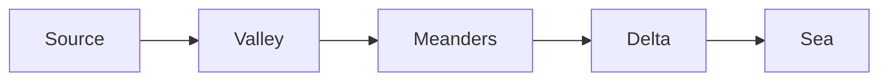

# The Life of Rivers

Rivers shape the land they cross. Over thousands of years a stream cuts its
valley, carries sand to the sea and builds new ground at its mouth.

## Where rivers begin

Most rivers start high in the mountains, where rain and melting snow gather
into small streams. The water is cold and fast, and it carries stones that
grind the riverbed deeper every spring.

> [!NOTE]
> A river's *source* is not always a single spring: the Danube has two.

## The middle course

Lower down, the slope eases and the river begins to wander. It swings from
side to side in wide loops called **meanders**, eating into the outer bank
and leaving sand on the inner one. We sat on the river bank and watched the
water turn slowly around the bend.

| River | Length (km) | Mouth |
| --- | --- | --- |
| Nile | 6,650 | Mediterranean Sea |
| Amazon | 6,400 | Atlantic Ocean |
| Danube | 2,850 | Black Sea |

## The delta

Near the sea the river slows down and drops what it carries. Layer after
layer, the sediment builds a delta: a fan of land, channels and marshes
that keeps growing into the water.

## Rivers and people

Cities grew on rivers because they gave water, food and a road to the
sea. Today they also give us energy, and they remind us how slowly, and how
patiently, the land is made.
